<a href="https://josh.codeffio.com">
  <picture>
    <source media="(prefers-color-scheme: dark)" srcset="assets/hero-dark.svg">
    
  </picture>
</a>

<picture>
  <source media="(prefers-color-scheme: dark)" srcset="assets/skills-dark.svg">
  
</picture>

  

<picture>
  <source media="(prefers-color-scheme: dark)" srcset="assets/about-dark.svg">
  
</picture>

I'm a full-stack developer from the Philippines with **9 years in PHP and JavaScript**. Most of that time has been spent on **Laravel APIs** and **Vue, Nuxt and React** front ends. I started as a part-time programmer and grew into senior and lead roles, which meant running sprint planning, grooming backlogs, reviewing code and shipping releases alongside PMs and designers.

Recent work includes moving a production app from Laravel + Inertia to a Laravel API with a Nuxt 4 front end without stopping feature work, and building a **RAG AI feature** that is live in production.

 

<picture>
  <source media="(prefers-color-scheme: dark)" srcset="assets/work-dark.svg">
  
</picture>

  <a href="https://josh.codeffio.com/projects/source/"><picture><source media="(prefers-color-scheme: dark)" srcset="assets/project-source-dark.svg"></picture></a>
  <a href="https://josh.codeffio.com/projects/pulse-events/"><picture><source media="(prefers-color-scheme: dark)" srcset="assets/project-pulse-dark.svg"></picture></a>

  <a href="https://josh.codeffio.com/projects/daloy/"><picture><source media="(prefers-color-scheme: dark)" srcset="assets/project-daloy-dark.svg"></picture></a>
  <a href="https://josh.codeffio.com/projects/galaw/"><picture><source media="(prefers-color-scheme: dark)" srcset="assets/project-galaw-dark.svg"></picture></a>

Live: <a href="https://app.thesource.wiki/">app.thesource.wiki</a> · <a href="https://pulseevents.ph">pulseevents.ph</a> · <a href="https://daloy.pro">daloy.pro</a> · <a href="https://galaw.codeffio.com">galaw.codeffio.com</a>

  

<picture>
  <source media="(prefers-color-scheme: dark)" srcset="assets/experience-dark.svg">
  
</picture>

| When | Role | Where |
| :-- | :-- | :-- |
| `2026` | **Full Stack Developer** (Contract) | OpenLot · Drupal + React real estate platform |
| `2023 – 2026` | **Senior Full Stack Developer**, team lead | GoTeam · Multiplai Source |
| `2021 – 2023` | **Senior Backend Engineer** | Zigzag Offshoring |
| `2020 – 2021` | **Full Stack Developer** | Let's Bee Delivery Services |
| `2017 – 2020` | **Senior Web Programmer** | Trendmedia Inc. |

 

<picture>
  <source media="(prefers-color-scheme: dark)" srcset="assets/toolbox-dark.svg">
  
</picture>

**Languages & frameworks:** PHP · Laravel · CodeIgniter · JavaScript · TypeScript · Node.js · Express · Vue · Nuxt · React · React Router · Inertia.js · Flutter · Tailwind CSS

**Backend & infra:** Laravel Vapor · Laravel Forge · AWS (EC2, RDS, S3) · Typesense · MySQL · PostgreSQL · Redis · Docker · REST APIs · multi-tenancy

**Testing & practice:** Pest · PHPUnit · mutation testing · TDD · CI/CD · code review · Agile/Scrum · RAG / AI features

 

<a href="https://josh.codeffio.com/#contact">
  <picture>
    <source media="(prefers-color-scheme: dark)" srcset="assets/contact-dark.svg">
    
  </picture>
</a>

  
  
  
  

<!-- Assets are generated by scripts/build_assets.py -->
